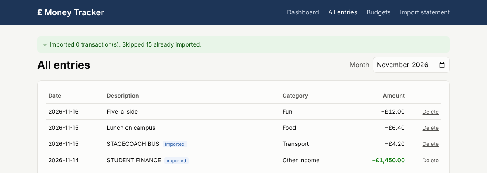

# Money Tracker

A small web app for keeping track of your money. You log what you earn and spend, see where it goes, set monthly budgets and import bank statements. It's built with **Python, Flask and SQLite**, and backed by **25 automated tests**.


## Features

- **Add income and spending** with an amount, a category, a date and an optional note.
- **Monthly dashboard** showing money in, money out, what's left over, and a bar for each category's spending.
- **Budgets:** set a monthly limit per category. You get a ⚠️ warning at 80% and a ⛔ alert when you go over. Each bar also shows its limit as a marker line.
- **Bank statement import:** upload a CSV with `Date, Description, Amount` and spending is sorted into categories automatically (Tesco → Food, Netflix → Fun, Trainline → Transport). Uploading the same statement twice is safe, because duplicates are skipped.
- **Browse any month**, and delete entries.

## How the money is handled

- **Money is stored as whole pence (integers), never as floats.** Floats can't hold 0.1 exactly: `0.1 + 0.2` gives `0.30000000000000004`, and those errors build up over hundreds of transactions. So `£12.50` is stored as `1250`, and amounts are parsed with Python's `Decimal`. A test proves the difference.
- **Every SQL query uses `?` placeholders**, so user input can never be run as SQL.
- **All output is escaped** by Jinja, so a description like `<script>` shows up as text. This is tested too.
- **Uploads are capped at 1 MB**, and only `.csv` files are accepted.
- **The database also checks the data:** `CHECK (amount_pence > 0)` and `CHECK (kind IN ('income','expense'))`. Bad data is blocked even if the app has a bug.

## Run it

```bash
python -m venv .venv
.venv\Scripts\activate        # Windows  (macOS/Linux: source .venv/bin/activate)
pip install -r requirements.txt
python run.py
```

Then open http://127.0.0.1:5000. The database file is created automatically in `instance/`.

**To try the import:** go to **Import statement** and upload `examples/sample_statement.csv`.

## Tests

```bash
pytest
```

There are 25 tests in two files:

| File | What it checks |
|---|---|
| `tests/test_finance.py` | The maths: converting £ to pence exactly, the float problem, category totals, income minus spending, the budget edge cases (79.99% is OK, 80% is a warning, exactly 100% is *not* over, 1p over *is* over), parsing a statement CSV and auto-categorising |
| `tests/test_app.py` | The whole app through Flask's test client, each test with a fresh temporary database: adding entries updates the totals, bad amounts are rejected, overspending shows an alert, re-uploading a statement doesn't double-count, and HTML in a description is escaped |

## Project structure

```
money-tracker/
├── run.py                  Starts the app
├── tracker/
│   ├── __init__.py         Flask app + routes (create_app factory)
│   ├── finance.py          The money maths: pure functions, no Flask, easy to test
│   ├── db.py               SQLite schema and queries
│   ├── templates/          Jinja HTML pages
│   └── static/style.css
├── tests/                  pytest suite
├── examples/sample_statement.csv
└── screenshots/
```

I kept the maths in `finance.py`, separate from the web code, so it can be tested without starting a server.

## Screenshots

| All entries | Budgets |
|---|---|
|  |  |

| Import a statement | Re-importing the same file |
|---|---|
|  |  |

## What I'd add next

- User accounts with hashed passwords (`werkzeug.security`), so each person sees only their own data
- CSRF protection on forms (Flask-WTF)
- Editing an entry's category after import, and learning from those corrections
- A spending-over-time chart across months
- Support for each bank's own CSV layout (Monzo, Lloyds, Barclays)
