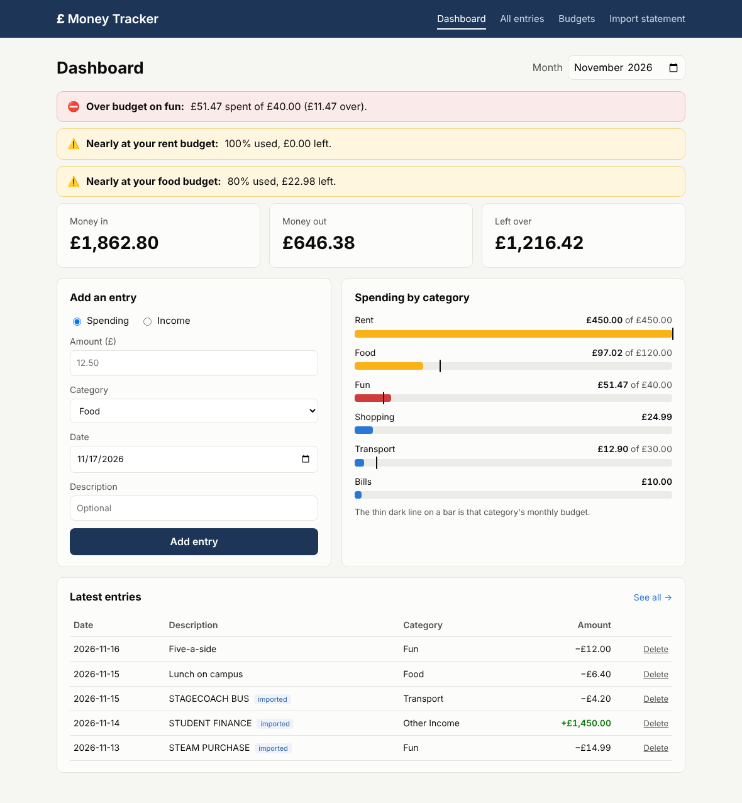
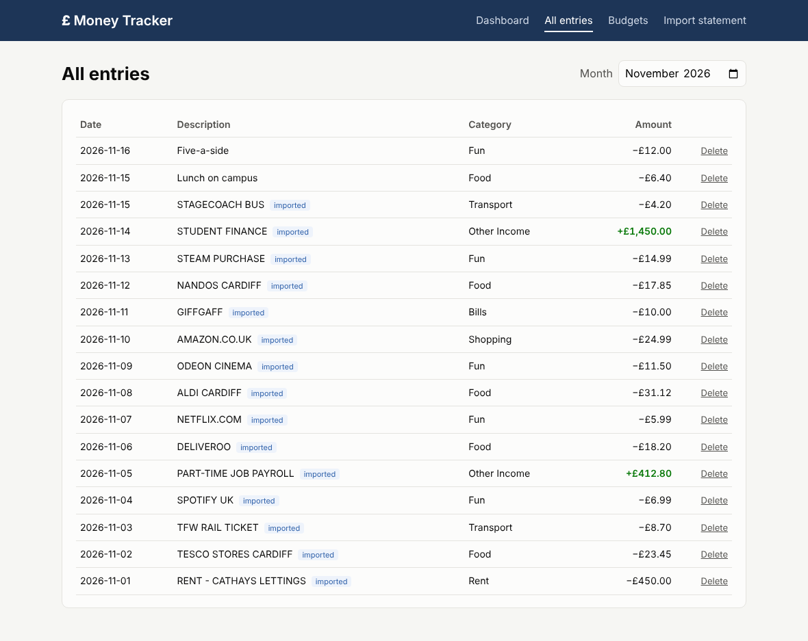
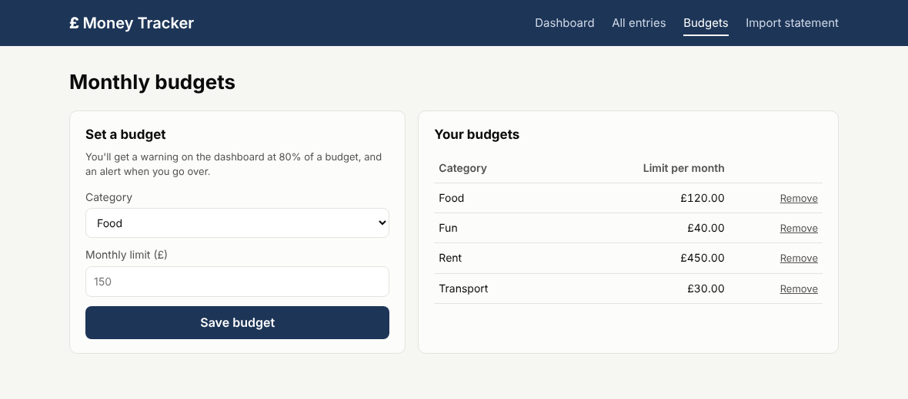
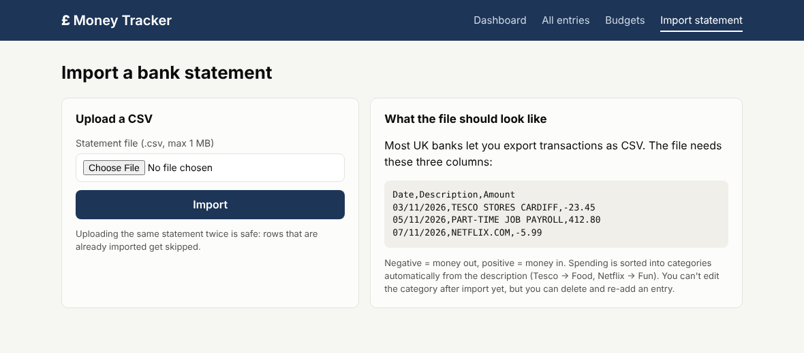

# Money Tracker

[](https://github.com/azmain2704-ship-it/money-tracker/actions/workflows/tests.yml)

A small Flask app I built to keep track of what I earn and spend each month. You can set budgets for things like food and fun, and it warns you when you're getting close or have gone over. You can also upload a bank statement CSV instead of typing everything in.

**Try it live: [money-tracker-a8r4.onrender.com](https://money-tracker-a8r4.onrender.com)** (it's loaded with a sample month of spending, everyone shares it and it resets whenever the free server restarts, so add or delete whatever you like. The first visit after a quiet spell takes about a minute while the server wakes up.)



## What it does

You add income or spending with an amount, category, date and an optional note. The dashboard shows money in, money out and what's left for the month, plus a bar for each category with your budget marked on it. You get a warning at 80% of a budget and an alert once you go over.

The statement import reads a CSV with `Date, Description, Amount` columns and guesses the category from the description, so Tesco goes under food and Netflix under fun. If you upload the same statement twice it skips the rows it already has.

## Built with

Python, Flask and SQLite, with pytest for the tests.

## Storing money as pence

The main thing I learned building this: don't store money as floats. In Python, `0.1 + 0.2` gives `0.30000000000000004`, and errors like that pile up over hundreds of transactions. So every amount is stored as a whole number of pence (£12.50 is saved as `1250`) and only turned back into pounds when it's displayed. There's a test that shows the float problem next to the fix.

Other things I made sure of:

- every SQL query uses `?` placeholders
- Jinja escapes everything on the page, so typing `<script>` into a note just shows the text
- uploads are capped at 1 MB and have to be `.csv`
- the database won't accept a zero or negative amount, even if the app has a bug

## Running it

```bash
python -m venv .venv
.venv\Scripts\activate          # macOS/Linux: source .venv/bin/activate
pip install -r requirements.txt
python run.py
```

Then go to http://127.0.0.1:5000. To try the import, upload `examples/sample_statement.csv` from the Import statement page.

## Tests

Run `pytest`. There are 27 tests. Some check the maths: pence conversion, category totals and the budget edge cases (80% counts as a warning, exactly 100% isn't over, 1p more is). The rest go through the whole app with Flask's test client and a fresh database each time. Writing them caught two real bugs: CSV errors pointed at the wrong line number, and "BUSINESS" was being filed under transport because it contains "bus".

The maths lives in `finance.py`, separate from the Flask code, so it can be tested without starting a server.

## Screenshots

| All entries | Budgets |
|---|---|
|  |  |

| Importing a statement | Importing it again |
|---|---|
|  |  |

## Next

User accounts, CSRF protection on the forms, being able to change a category after importing, and a chart of spending across months.
